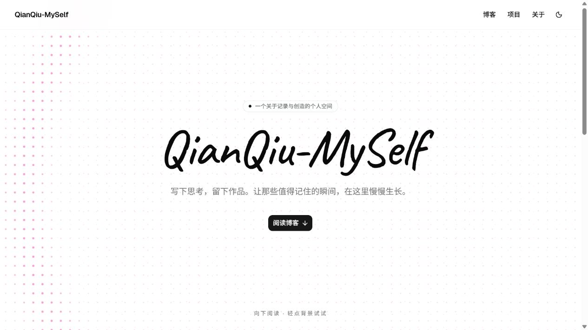
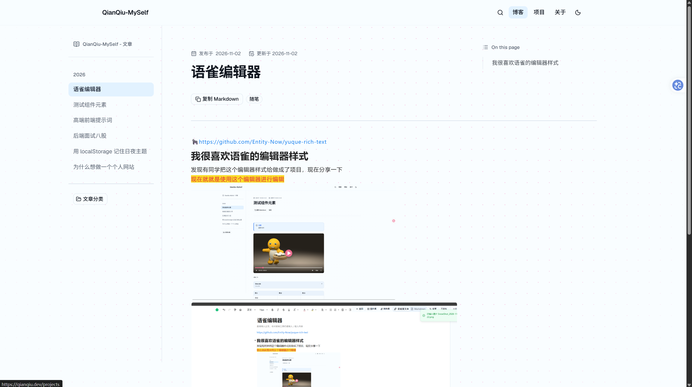
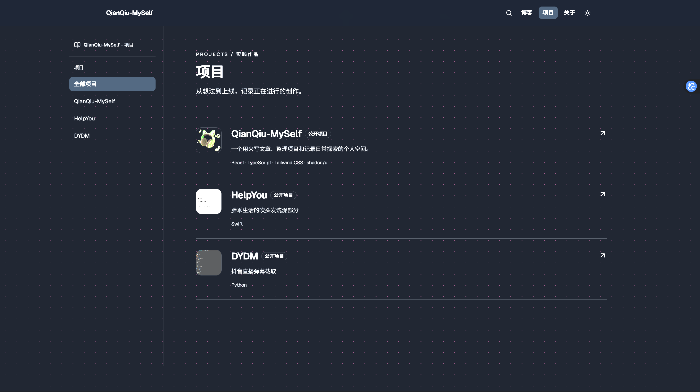

# QianQiu-MySelf

[](https://deploy.workers.cloudflare.com/?url=https://github.com/YYY887/NiceSelf)

React + TypeScript + Vite 前台，Go + SQLite 内容 API。界面使用 Tailwind CSS v4 与 shadcn/ui。线上使用 Cloudflare Workers + D1 + R2，本地用 Go + SQLite。

## 界面预览

**首页**：点阵涟漪首屏，顶部可切换日夜主题，下方是文章与项目入口。



**文章阅读页**：左侧章节目录可折叠，代码块带高亮与复制按钮，右侧是正文。



**项目展示页**：项目封面与截图图库，竖屏截图自动套手机相框。



这三张图放在 `public/projects/qianqiu-myself/`，既是文档配图，也是站点自带的示例项目图：前端请求 `/projects/qianqiu-myself/home.png` 就能直接拿到，`home.png` 同时用作内置示例项目的封面。换成自己的截图时保持同名同路径，或者到后台「项目」里上传新图并在 `src/lib/site-content.tsx` 更新示例地址。

## 一键部署到 Cloudflare

点上面的按钮就能把自己的站点跑起来：Cloudflare 会把这个仓库复制到你自己的 GitHub 账号，自动新建 D1 数据库和 R2 存储桶并绑定，跑完 D1 初始化脚本后部署 Worker，全程不需要本地装任何东西。

| 需要准备 | 说明 |
| --- | --- |
| Cloudflare 账号 | 免费账号即可，D1 与 R2 都有免费额度 |
| GitHub 账号 | 部署时会把仓库复制到你的名下，方便后续继续开发 |
| 可选的 GitHub OAuth App | 只有前台评论功能需要，可以部署完再配 |

按钮的地址用的是本仓库的真实地址。如果你 fork 或改名了，把上面那行的 `url=` 换成你自己的仓库地址即可：

```md
[](https://deploy.workers.cloudflare.com/?url=https://github.com/<你的用户名>/<你的仓库名>)
```

也可以直接用部署页地址：`https://deploy.workers.cloudflare.com/?url=https://github.com/<你的用户名>/<你的仓库名>`

### 部署时会自动完成的事

- 复制仓库到你的 GitHub 账号，并让你确认项目名、Worker 名、D1 库名和 R2 桶名。
- 按 `wrangler.toml` 里的 `[[d1_databases]]` 新建 D1 数据库，绑定为 `DB`，并把真实 `database_id` 写回新仓库。
- 按 `[[r2_buckets]]` 新建 R2 存储桶 `qianqiu-uploads`，绑定为 `UPLOADS`，用于上传文件与数据库备份。
- 构建命令使用 `npm run build`，部署命令使用 `npm run deploy:cf`；`deploy:cf` 会先执行 `wrangler d1 migrations apply DB --remote`，把 `migrations/0001_init.sql` 里的表结构建好。
- 部署完成后会得到一个 `https://<Worker 名>.<你的子域>.workers.dev` 地址，同时 `scripts/capture-deploy.mjs` 会把该地址回填进 `wrangler.toml` 的 `PUBLIC_URL` 并补一次部署。

### 部署完以后

1. 打开线上地址，确认首页正常；后台在 `/admin`，初始账号 `admin` / `qianqiu123`。首次登录后立刻在「站点设置」里改用户名和密码。
2. 想用前台评论，就在 GitHub 创建 OAuth App，回调地址填后台显示的 `https://<你的域名>/api/auth/github/callback`，然后把 Client ID 与 Secret 填进 `/admin/settings`。也可以写成 Worker 变量或机密：`GITHUB_CLIENT_ID`、`GITHUB_CLIENT_SECRET`、可选的 `GITHUB_TOKEN`（后台保存的值优先）。
3. 绑定自己的域名：Cloudflare 控制台 → Workers → 选中这个 Worker → 设置 → 域和路由 → 添加自定义域名；同时把 `wrangler.toml` 里的 `PUBLIC_URL` 改成新域名再重新部署一次，否则同源校验和 GitHub 回调还是旧地址。
4. 想在本机继续开发线上库，把部署时生成的 `database_id` 填进 `wrangler.toml`（新仓库里已经写好），再跑 `npm run db:migrate:local && npm run dev:worker`。

`PUBLIC_URL` 必须是站点对外的真实地址；留空时会回落到请求自身的 origin，只适合临时验证，Cookie 的 `Secure` 标记和同源校验都会跟着这个值走。

## 本地开发

需要 Node.js、npm 和 Go 1.26。安装依赖后同时启动前后端：

```bash
npm install
npm run dev:full
```

打开 [首页](http://127.0.0.1:5173/) 或 [管理后台](http://127.0.0.1:5173/admin)。后台使用账号密码登录，初始账号为 `admin` / `qianqiu123`。登录后可在「站点设置」中修改用户名和密码。首次建库时也可用 `server/.env` 的 `ADMIN_USERNAME`、`ADMIN_PASSWORD` 覆盖初始账号。

现有开发服务若已启动，可分别运行 `npm run dev` 和 `npm run dev:api`。Vite 将 `/api` 代理到 Go 的 8080 端口。SQLite 数据写入 `server/data/site.db`，首次启动会导入两篇示例文章、三项分类和一个项目。公开页面在 API 暂不可用时会显示内置示例内容；后台编辑需要 Go API 运行。

只启动 Go 后端时，在项目根目录运行 `npm run dev:api`，或在 PowerShell 中先进入 Go 模块目录：

```powershell
cd server
go run ./cmd/api
```

`go.mod` 位于 `server/`，因此直接在项目根目录执行 `go run ./server/cmd/api` 或 `go run ./server/cmd/api/main.go` 会找不到当前 Go 模块。后端的 `.env` 和 `data/` 路径也以 `server/` 为工作目录。

## 后台功能

- 文章：列表进入写作台，使用 Milkdown Crepe 在正文中直接编辑并实时呈现 Markdown；标题在上、右侧设置摘要、分类、标签与日期。可导入 `.md`；点击“插入图片”先从文件库搜索并选择已有图片，也可在弹窗中上传新图后插入。右键图片可将宽度设为 40%、60%、80% 或 100%（默认 60%）；公开文章中的图片可点击放大。支持保存草稿、发布与删除。导入的原始 `.md` 也保存到文件库。
- 项目：列表进入编辑页，支持 Logo、一次上传多张截图、选择封面、Markdown 说明、网站及 GitHub 按钮名称、自定义链接、技术栈、排序及发布状态。填写 GitHub 地址后，详情页显示对应按钮。竖屏截图会在前台以手机相框展示。
- 文章和项目列表左侧有拖动把手，可调整公开展示顺序；松开后自动写入 SQLite。项目编辑页不再使用数字输入排序。
- 前台 `/projects` 显示项目列表；每个项目通过 `/projects/:slug` 独立打开。多张竖屏截图在桌面端并排展示，手机端按空间换行；截图和文章图片可点击放大。
- 分类和标签默认显示列表，通过右侧抽屉新建或编辑；另有站点名称、关于页文案和 GitHub 用户名管理。
- 文件库收录上传的图片与附件，支持网格/列表切换、按名称搜索和复制地址。上传时按实际内容识别并保存格式，SVG 和扩展名写错的文件也可使用；无法识别的文件以附件提供下载。上传前会比对文件内容；相同文件直接复用已有地址，不生成新副本。已有重复记录保留原地址，避免旧文章或项目图片失效。SQLite 数据库可在后台创建备份并一键下载；上传文件单独保存在 `server/data/uploads`。
- 评论列表、隐藏、恢复与删除。

文章和项目在有未保存修改时显示悬浮操作栏，保存后通过 Toast 提示结果。编辑内容会按条目暂存在浏览器 `localStorage`，重新打开时自动恢复；成功保存或选择“放弃修改”后清除对应暂存。未发布的草稿仍保留悬浮发布入口。文章正文支持右键格式菜单（加粗、斜体、标题、引用、代码块、复制和插入图片）。

前台顶部和后台侧栏的主题切换从按钮位置显示圆形扩散过渡；系统启用“减少动态效果”或浏览器不支持页面过渡时直接切换，主题选择继续存入 `localStorage`。

上传的 Markdown 可包含简单的 YAML 风格头部，例如：

```md
---
title: 一篇新文章
slug: new-article
category: notes
tags: [go, react]
---

## 开始

正文内容。
```

导入时文章先保存为草稿，检查后在后台发布。

文章正文支持 Fumadocs 风格的提示框、独立链接卡片和可复制文本块；后台编辑器底部及右键菜单可插入模板：

````md
> [!NOTE] 注意
> 这里是提示内容。

https://github.com/owner/repo

```copy
这里的文字可以一键复制
```
````

单独占一行的 HTTP 链接会自动显示为卡片；GitHub 仓库链接通过 Go API 读取简介、星标与 Fork 数。文章中的 `##` 章节默认展开，点击章节标题可收起或展开其下内容。大纲识别 `#` 到 `######` 六级标题，点击折叠章节内的标题会先展开对应章节，再跳转并高亮目标标题；手机端通过右下角悬浮按钮打开“文章目录”抽屉。后台概览、文章、项目、分类、文件库等页面分别有 `/admin`、`/admin/articles`、`/admin/projects`、`/admin/taxonomy`、`/admin/files` 等独立地址。

## 用命令行部署（已有 Cloudflare 账号）

不想走一键部署按钮时，本地等价流程如下。先登录一次 `npx wrangler login`，再执行：

```bash
npm install
npx wrangler d1 create qianqiu-myself          # 把输出的 database_id 填进 wrangler.toml
npx wrangler r2 bucket create qianqiu-uploads  # 桶名与 wrangler.toml 保持一致
npm run db:migrate:remote                      # 建表，等价于 wrangler d1 migrations apply DB --remote
npm run build
npm run deploy                                 # 构建 + 部署 + 回填线上地址
```

只改后端时可以用 `npm run deploy:cf`，它不重复构建前端，只跑迁移和部署。

用按钮部署过之后，Cloudflare 会在你的新仓库上挂一条 Workers Builds 构建：以后每次 push 到 `main`，它都会自动重新构建并发布，不需要本地再跑部署命令。构建配置里的构建命令是 `npm run build`，部署命令是 `npm run deploy:cf`，需要改的话在 Cloudflare 控制台的 Worker → 设置 → 构建里调整。

数据表定义在 `migrations/0001_init.sql`，与 Worker 内的 `worker/src/schema.sql` 内容一致，两边都使用 `CREATE TABLE IF NOT EXISTS`，所以不论先跑哪个都不会冲突；后续加字段时新增 `0002_*.sql` 之类的文件即可，`wrangler d1 migrations apply` 会按文件名顺序执行未应用的迁移。

线上地址默认为 `https://qianqiu.dev`，也可以换成 `https://<Worker 名>.<你的子域>.workers.dev`。后台初始账号仍是 `admin` / `qianqiu123`，登录后请立刻修改。

后台文章编辑器支持 `Ctrl+S`（macOS 为 `⌘+S`）保存当前发布状态。项目网站、仓库与自定义链接可填写 `qianqiu.dev` 这样的域名，保存时会补全 `https://`；其他无效地址会提示对应字段。

## GitHub 登录

后台管理使用独立的账号密码，与 GitHub 登录分开。GitHub OAuth 只用于前台评论。在 GitHub 创建 OAuth App 后，到 `/admin/settings` 填写 Client ID 和 Client Secret。回调地址后台会显示，线上一般为：

```text
https://qianqiu.dev/api/auth/github/callback
```

本地开发时回调为：

```text
http://127.0.0.1:5173/api/auth/github/callback
```

也可以把同样的值写进 `server/.env` 作为备用；后台保存的配置优先。OAuth Secret 和可选的 GitHub Token 只保存在服务端，不要放入 Vite 环境变量。上线时将 `PUBLIC_URL` 设为实际 HTTPS 站点地址；构建前端后可设置 `STATIC_DIR=../dist`，由 Go 同时提供静态页面和 API。公开 GitHub 资料、仓库和贡献数据由后端读取并缓存，再提供给前台。

附件默认存在本地（开发环境磁盘，线上 R2）。在 `/admin/settings` 配置 WebDAV 后，可以把新上传转到网盘；文件库会分别保存原始文件名、存储名和可访问链接。若网盘提供公开直链，填写“公开访问前缀”；否则仍通过本站 `/api/uploads` 代理。

## 验证

```bash
npm run build
npm run lint
npm run test:api
```

后台代码位于 `src/pages/admin-page.tsx`、`src/components/admin/`；Go API 位于 `server/cmd/api/` 与 `server/internal/app/`；线上 Worker、D1、R2 逻辑位于 `worker/src/`。组件库配置位于 `components.json`。
